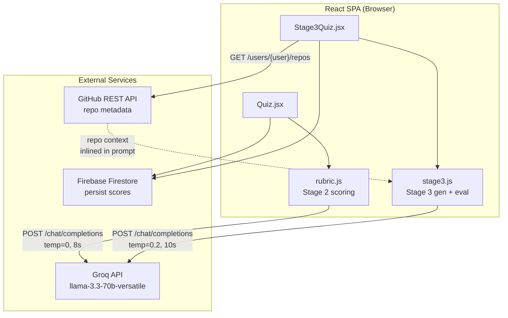
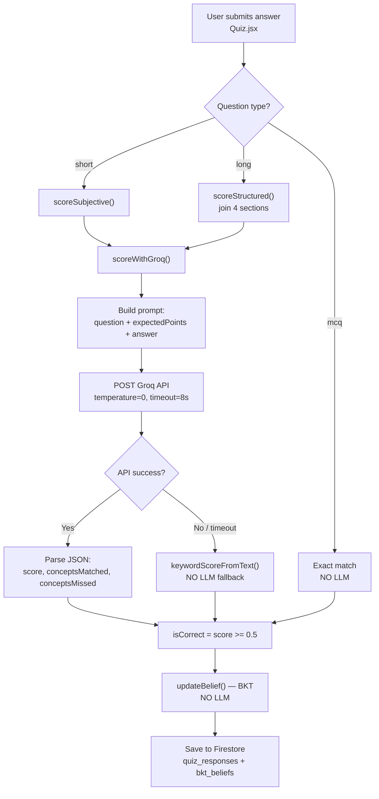
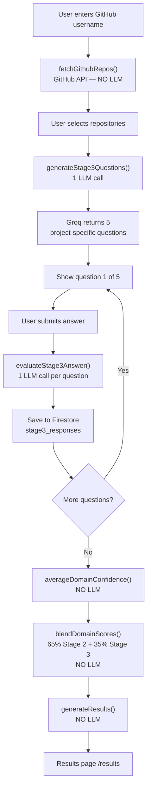
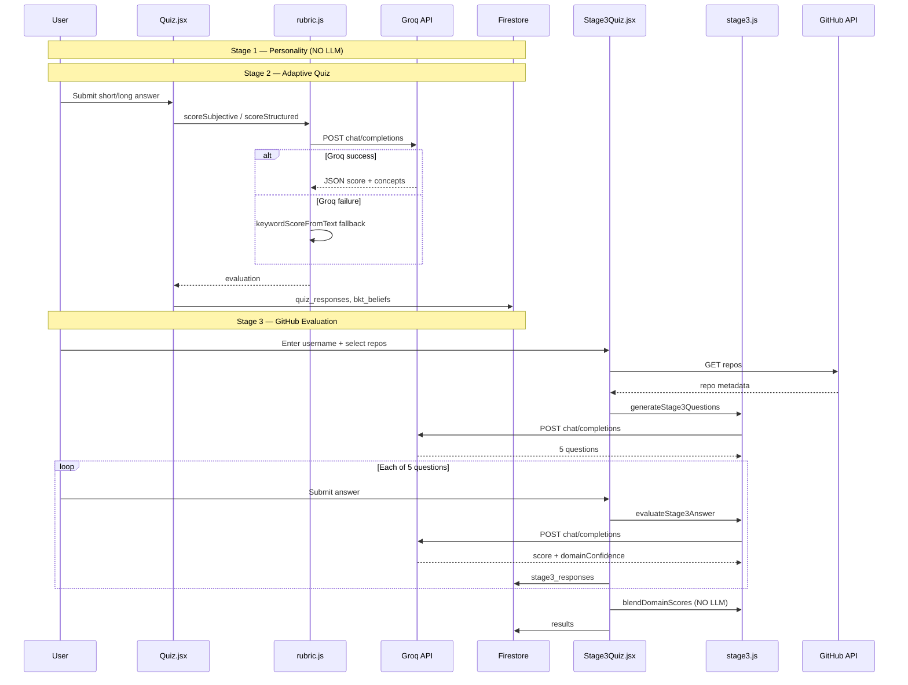
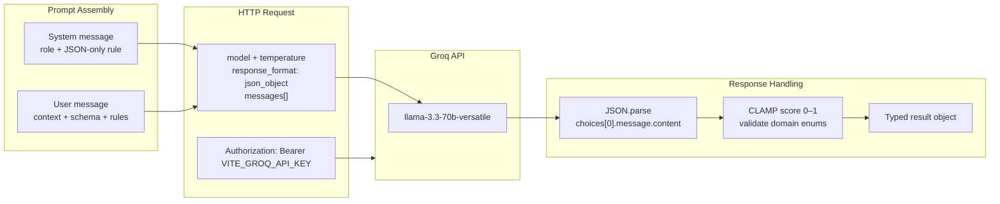
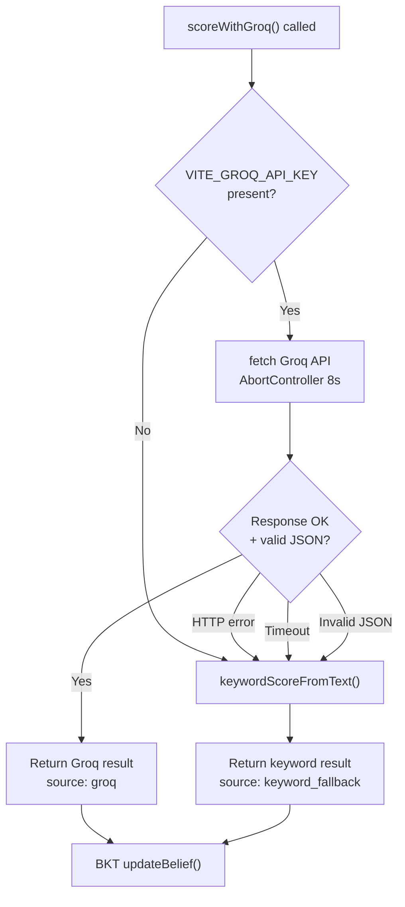
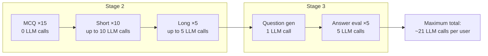
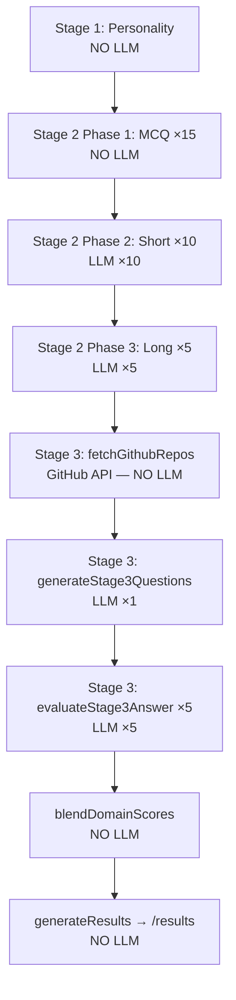

# LLM Workflow — Logic Document
## Engineering Career Assessment System

> **Implementation note:** All LLM calls run **client-side** in the React frontend via raw `fetch`.
> There is no backend proxy, no LangChain, no RAG, and no agent framework.
> Provider: **Groq** (OpenAI-compatible chat completions API).

---

## General Notes

- **Provider:** Groq — `https://api.groq.com/openai/v1/chat/completions`
- **Default model:** `llama-3.3-70b-versatile` (override via `VITE_GROQ_MODEL`)
- **Auth:** `VITE_GROQ_API_KEY` (browser-exposed; prefixed with `VITE_`)
- **Output:** All LLM responses use `response_format: { type: 'json_object' }`
- **SDK:** None — direct HTTP `fetch` only
- **MCQ scoring:** Never uses LLM (exact match in `Quiz.jsx`)
- **Result generation:** Never uses LLM (rule-based in `resultGenerator.js`)

### Source Files

| File | Responsibility |
|---|---|
| `src/engine/rubric.js` | Stage 2 subjective answer scoring via Groq |
| `src/engine/stage3.js` | Stage 3 question generation + answer evaluation via Groq |
| `src/pages/Quiz.jsx` | Triggers Stage 2 LLM on short/long submit |
| `src/pages/Stage3Quiz.jsx` | Orchestrates full Stage 3 LLM workflow |

---

## Architecture Diagrams

### Diagram 1 — High-Level LLM System Architecture



---

### Diagram 2 — Stage 2 LLM Scoring Flow



---

### Diagram 3 — Stage 3 GitHub LLM Workflow



---

### Diagram 4 — End-to-End Assessment LLM Sequence



---

### Diagram 5 — Groq Request / Response Pipeline



---

### Diagram 6 — Stage 2 Error Handling & Fallback



---

### Diagram 7 — LLM Call Budget Per User



---

## Part 1: LLM Integration Overview

### When LLM Is Used

| Stage | Trigger | Function | Max calls |
|---|---|---|---|
| Stage 2 — Phase 2 | User submits short answer | `scoreSubjective()` | 10 |
| Stage 2 — Phase 3 | User submits long answer | `scoreStructured()` | 5 |
| Stage 3 | User generates questions | `generateStage3Questions()` | 1 |
| Stage 3 | User submits each answer | `evaluateStage3Answer()` | 5 |
| **Total (full assessment)** | | | **~21** |

### When LLM Is NOT Used

- Personality assessment (Stage 1)
- MCQ answers (Stage 2, Phase 1 — 15 questions)
- BKT belief updates (`bkt.js`)
- Adaptive question selection (`questionSelector.js`)
- GitHub repo fetch (`fetchGithubRepos()` — REST API only)
- Domain score blending (`blendDomainScores()`)
- Final career results (`generateResults()`)

---

## Part 2: Groq API Contract

### Request Shape (all LLM calls)

```
POST https://api.groq.com/openai/v1/chat/completions

Headers:
  Authorization: Bearer {VITE_GROQ_API_KEY}
  Content-Type: application/json

Body:
{
  "model": "{VITE_GROQ_MODEL || 'llama-3.3-70b-versatile'}",
  "temperature": <see table below>,
  "response_format": { "type": "json_object" },
  "messages": [
    { "role": "system", "content": "<system prompt>" },
    { "role": "user", "content": "<user prompt>" }
  ]
}
```

### Model Settings by Workflow

| Workflow | Temperature | Timeout | System prompt |
|---|---|---|---|
| Stage 2 scoring | 0 | 8s | `"You are a strict evaluator returning only JSON."` |
| Stage 3 question gen | 0.2 | 10s | `"You are an expert technical interviewer. Return only JSON."` |
| Stage 3 answer eval | 0.2 | 10s | `"You are a strict evaluator. Return only JSON."` |

### Response Parsing

```
FUNCTION parseGroqResponse(httpResponse):

  data = JSON.parse(httpResponse.body)
  content = data.choices[0].message.content
  parsed = JSON.parse(content)

  # Post-parse validation (both engines):
  score = CLAMP(parsed.score, 0.0, 1.0)

  RETURN parsed
```

---

## Part 3: Stage 2 — Subjective Answer Scoring

### Overview

Used when the adaptive quiz presents **short** (Phase 2) or **long/structured** (Phase 3) questions.
Groq evaluates semantic correctness against `expectedPoints` from the question bank.

On API failure or timeout, the system falls back to deterministic keyword matching (non-LLM).

---

### Entry Points

```
FUNCTION scoreSubjective(answerText, expectedPoints, questionText):
  TRY:
    RETURN scoreWithGroq({ type: 'short', ... })
  CATCH:
    RETURN keywordScoreFromText(answerText, expectedPoints)
           + { source: 'keyword_fallback' }

FUNCTION scoreStructured(answerStructured, expectedPoints, questionText):
  fullText = JOIN sections [problemUnderstanding, approach, tradeoffs, decision]
  TRY:
    RETURN scoreWithGroq({ type: 'long', answerText: fullText, ... })
  CATCH:
    RETURN keywordScoreFromText(fullText, expectedPoints)
           + { source: 'keyword_fallback' }
```

---

### LLM Call — scoreWithGroq()

**Called from:** `Quiz.jsx` → `handleSubmit()` when `question.type === 'short' | 'long'`

**User prompt template:**

```
You are evaluating a student's {short|long} answer.
Question: {questionText}
Expected points: {JSON.stringify(expectedPoints)}
Student answer: {answerText}

Return only valid JSON:
{
  "score": number,
  "conceptsMatched": string[],
  "conceptsMissed": string[]
}

Rules:
- score must be between 0 and 1
- evaluate semantic correctness, not exact wording
- keep conceptsMatched and conceptsMissed aligned with expected points
```

**Expected response:**

```json
{
  "score": 0.75,
  "conceptsMatched": ["caching", "invalidation"],
  "conceptsMissed": ["consistency model"]
}
```

**Downstream use:**

```
isCorrect = (score >= 0.5)
updateBelief(currentDomainBelief, isCorrect)   # BKT — non-LLM
```

---

### Fallback — keywordScoreFromText() (non-LLM)

```
FUNCTION keywordScoreFromText(text, expectedPoints):

  clean = lowercase(text) with punctuation stripped

  FOR EACH point IN expectedPoints:
    keywords = split point into words
    matched IF any keyword (length > 3) appears in clean

  score = matchedCount / totalExpectedPoints
  isCorrect = (score >= 0.5)

  RETURN { score, isCorrect, source: 'keyword_fallback' }
```

---

## Part 4: Stage 3 — GitHub-Grounded LLM Workflow

### Overview

After Stage 2 completes, the student enters a GitHub username, selects repositories,
and answers **5 project-specific questions** generated and evaluated by the LLM.

GitHub metadata is injected directly into prompts (context stuffing — not RAG).

---

### Full Workflow

```
FUNCTION stage3LLMWorkflow(user):

  # Step 0 — GitHub fetch (NOT LLM)
  repos = fetchGithubRepos(user.githubUsername)
  selected = user.selectsRepos(repos)

  # Step 1 — Question generation (1 LLM call)
  questions = generateStage3Questions({
    githubUsername,
    repos: selected,
    priorDomainBeliefs: bktBeliefs
  })

  evaluations = []

  # Step 2 — Answer loop (5 LLM calls)
  FOR EACH question IN questions[0..4]:
    answer = user.submitAnswer()
    eval = evaluateStage3Answer({
      question,
      answerText: answer,
      repoContext: selected
    })
    evaluations.push(eval)
    SAVE to Firestore stage3_responses

  # Step 3 — Post-LLM blending (NOT LLM)
  stage3Domains = averageDomainConfidence(evaluations)
  blended = blendDomainScores(stage2Beliefs, stage3Domains, 0.35)
  results = generateResults({ domainBeliefs: blended, ... })

  RETURN results
```

---

### Step 1 — generateStage3Questions() (1 LLM call)

**Trigger:** User clicks "Generate Questions" after selecting ≥1 repo  
**File:** `src/engine/stage3.js`

**Input context (in user prompt):**

| Field | Source | Limit |
|---|---|---|
| GitHub username | User input | — |
| Projects | Selected repos | Up to 8 repos |
| Per-repo fields | GitHub API | name, description, language, topics, stars |
| Prior domain beliefs | Firestore `bkt_beliefs` | All 8 domains |
| Allowed domains | Hardcoded enum | 8 domain keys |

**Allowed domains:**

```
web_dev, ml, system_design, dsa, security,
networking, operating_systems, databases
```

**User prompt template:**

```
Generate exactly 5 interview questions grounded in the selected GitHub projects.
GitHub username: {githubUsername}
Projects: {JSON.stringify(trimmedRepos)}
Prior domain beliefs: {JSON.stringify(priorDomainBeliefs)}
Allowed domains: {JSON.stringify(DOMAIN_KEYS)}

Return JSON:
{
  "questions": [
    {
      "questionId": "stage3_q1",
      "text": "question",
      "domain": "one of allowed domains",
      "difficulty": "moderate|deep",
      "expectedPoints": ["point1", "point2", "point3"]
    }
  ]
}

Rules:
- Questions must be project-specific and ownership-testing.
- Include implementation and design depth.
- expectedPoints should be concise and concrete.
```

**Expected response:** Exactly 5 questions, validated and clamped in code.

---

### Step 2 — evaluateStage3Answer() (5 LLM calls)

**Trigger:** User submits answer for current question (once per question)

**Input context (in user prompt):**

| Field | Source |
|---|---|
| Question text | Generated in Step 1 |
| Question domain | Generated in Step 1 |
| Expected points | Generated in Step 1 |
| Repo context | Selected repos (up to 5) |
| Student answer | User input |

**User prompt template:**

```
Evaluate this answer for correctness, depth, and practical ownership.
Question: {question.text}
Question domain: {question.domain}
Expected points: {JSON.stringify(question.expectedPoints)}
Repo context: {JSON.stringify(repoContext)}
Answer: {answerText}
Allowed domains: {JSON.stringify(DOMAIN_KEYS)}

Return JSON:
{
  "score": number,
  "feedback": "short feedback",
  "isCorrect": boolean,
  "domainConfidence": {
    "web_dev": number,
    "ml": number,
    "system_design": number,
    "dsa": number,
    "security": number,
    "networking": number,
    "operating_systems": number,
    "databases": number
  }
}

Rules:
- score range: 0 to 1.
- domainConfidence values range: 0 to 1.
- Higher confidence for domains strongly demonstrated in answer.
- Do not include text outside JSON.
```

**Expected response:**

```json
{
  "score": 0.75,
  "feedback": "Good explanation of caching layer.",
  "isCorrect": true,
  "domainConfidence": {
    "web_dev": 0.8,
    "ml": 0.1,
    "system_design": 0.6,
    "dsa": 0.3,
    "security": 0.2,
    "networking": 0.1,
    "operating_systems": 0.1,
    "databases": 0.4
  }
}
```

**Persisted to Firestore:** `stage3_responses/{uid}/answers/{questionId}`

---

### Step 3 — Post-LLM Processing (non-LLM)

After all 5 answers are evaluated:

```
FUNCTION finalizeStage3(evaluations, stage2Beliefs):

  # Average domain signals across all 5 evaluations
  stage3Domains = averageDomainConfidence(evaluations)

  # Weighted blend: 65% Stage 2 BKT + 35% Stage 3 LLM signals
  blended = blendDomainScores(stage2Beliefs, stage3Domains, 0.35)

  FOR EACH domain IN DOMAIN_KEYS:
    blended[domain] = (1 - 0.35) * stage2[domain] + 0.35 * stage3[domain]

  results = generateResults({ domainBeliefs: blended, ... })
  SAVE to Firestore results/{uid}

  RETURN results
```

---

## Part 5: Shared Groq Wrapper (Stage 3)

Stage 3 centralizes all calls through `callGroqJSON()`:

```js
// src/engine/stage3.js
async function callGroqJSON(messages, { timeoutMs = 10000 } = {}) {
  const { apiKey, model } = getGroqConfig();
  const controller = new AbortController();
  setTimeout(() => controller.abort(), timeoutMs);

  const res = await fetch('https://api.groq.com/openai/v1/chat/completions', {
    method: 'POST',
    headers: {
      Authorization: `Bearer ${apiKey}`,
      'Content-Type': 'application/json',
    },
    body: JSON.stringify({
      model,
      temperature: 0.2,
      response_format: { type: 'json_object' },
      messages,
    }),
    signal: controller.signal,
  });

  const data = await res.json();
  return JSON.parse(data.choices[0].message.content);
}
```

Stage 2 uses an inline equivalent inside `scoreWithGroq()` with `temperature: 0` and `timeoutMs: 8000`.

---

## Part 6: End-to-End LLM Sequence

See **Diagram 4** (sequence) and **Diagram 7** (call budget) in [Architecture Diagrams](#architecture-diagrams).



---

## Part 7: Error Handling & Fallbacks

| Scenario | Stage 2 behavior | Stage 3 behavior |
|---|---|---|
| Missing API key | Throws → keyword fallback | Throws → user sees error toast |
| HTTP error (4xx/5xx) | keyword fallback | Error toast, retry |
| Timeout (8s / 10s) | AbortController → keyword fallback | AbortController → error toast |
| Invalid JSON from model | Catch → keyword fallback | Catch → error toast |
| Empty answer | score = 0 (no LLM call) | score = 0 (no LLM call) |

Stage 2 always degrades gracefully to keyword matching.
Stage 3 requires LLM success — there is no non-LLM fallback for question gen or evaluation.

---

## Part 8: What Is Explicitly Out of Scope

The following are **not** part of the LLM layer in this codebase:

| Feature | Status |
|---|---|
| RAG / vector retrieval | Not implemented |
| Embeddings | Not implemented |
| Agent loops / tool calling | Not implemented |
| LangChain / LangGraph | Not used |
| Backend LLM proxy | Not implemented |
| Multi-model routing | Not implemented |
| Fine-tuning | Not implemented |
| Firebase `@firebase/ai` | Transitive dep only — not imported |

GitHub repo metadata is passed **inline in the user prompt** (context stuffing).

---

## Part 9: Environment Variables

| Variable | Required | Default | Used by |
|---|---|---|---|
| `VITE_GROQ_API_KEY` | Yes (for LLM features) | — | All Groq calls |
| `VITE_GROQ_MODEL` | No | `llama-3.3-70b-versatile` | All Groq calls |

See `.env.example` for the full list including Firebase and NewsData keys.

---

## Related Documents

| Document | Contents |
|---|---|
| `04_bkt_rubric_logic.md` | BKT engine + deterministic rubric spec (design doc) |
| `stage3.md` | Stage 3 product goals and question types (conceptual) |
| `02_api_contract.md` | Firestore data access (no HTTP API) |
| `01_uiux_flow.md` | UI screens including `/quiz/stage3` |

**Note:** `04_bkt_rubric_logic.md` describes a fully deterministic keyword rubric for Stage 2.
The current implementation uses **Groq as primary** with keyword matching as fallback only on API failure.
